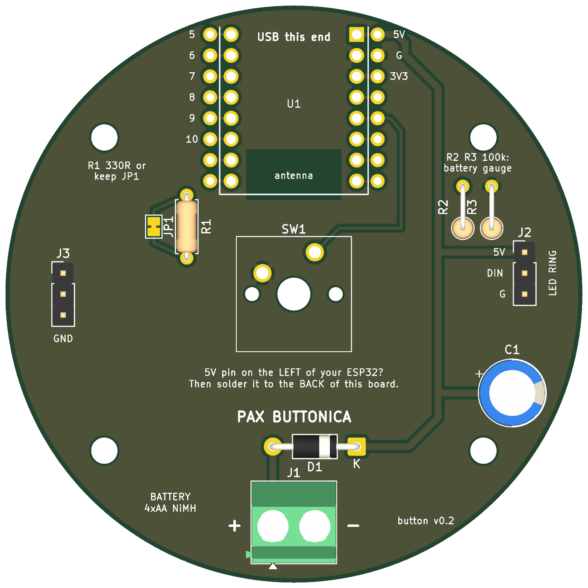

# The button's carrier board

A 70 mm round, two-layer board that every part of a button solders onto, so the only loose wires left are three to the LED ring and two to the batteries.



**Revision 0.2. Status: designed, rule-checked, never manufactured.** (v0.1, the first one ordered, is the same board without R2/R3 and the number box, and with C1 nearer the middle; it works the same.) KiCad's design-rule check passes with no violations and nothing unconnected. No board has been made, and the ESP32 module's footprint was drawn from published dimensions, not from a module in hand. Order a small batch and test one before building six.

## What's on it

| Ref | Part | Notes |
|---|---|---|
| U1 | ESP32-C3 SuperMini | Top of the board, USB-C at the rim. A **spare solder hole sits beside every pin**, so anything the module can do is reachable later: extra buttons, a speaker amp, battery sensing. |
| SW1 | MX-style keyboard switch | Dead centre. Any Cherry-MX-compatible switch, 3-pin or 5-pin. One side to ground, the other to the 5th pin on the module's power side. |
| J1 | Battery, 4 × AA NiMH | A 5.08 mm screw terminal, or just solder the holder's leads into the holes. **+ is on the left.** |
| D1 | 1N5817 diode | Reverse-polarity protection. Stripe to the right (marked K). |
| C1 | 1000 µF capacitor | Near the rim, below the LED connector, where it clears both the 8-LED and the 50 mm 12-LED ring. Stripe (negative) away from the + mark. |
| R2, R3 | 100 kΩ × 2, optional | A battery gauge: they halve the battery voltage for the ESP32 to read. Fit both and set `BATTERY_PIN` in the firmware (the fourth pin on the 5V side, usually 4); the test bench and the game then show each button's battery. Leave them off and nothing changes. |
| J2 | LED ring | 5V · DIN · G. Solder the ring's three wires straight in, or fit a pin header. |
| R1 / JP1 | 330 Ω, optional | JP1 is a jumper that is *already bridged* on the bare board, so with R1 left empty everything works. To use the resistor: fit R1 and cut the thin link between JP1's two pads. |
| J3 | Three ground holes | For the other leg of any extra buttons. |
| H1–H4 | M3 mounting holes | On a 46 × 38 mm rectangle. |
| Back | "No." box | Somewhere to write which button this is. |

The ground is a copper pour on both sides. There is no copper under the module's antenna.

## Two things the board deliberately does not assume

1. **Which way the module's GPIO numbers run.** Sources disagree on whether the five pins after 3V3 are labelled 4-3-2-1-0 or 0-1-2-3-4. The switch goes to the **fifth pin on the 5V side**. Read the number printed beside that pin on your module and put it in `firmware/button/config.h` as the first entry of `BUTTON_PINS`. The LED data line goes to GPIO10, which everyone agrees on.
2. **That your module isn't mirrored.** Looking down on the module with USB-C at the top, 5V should be the top pin on the **right**. If yours has 5V on the left, solder the module to the **back** of the board instead; flipping it swaps the rows back. Check before you solder: it's printed on both sides of the board too.

## Assembly

Step by step in [`docs/HARDWARE.md`](../../docs/HARDWARE.md#putting-a-button-together-on-the-board): diode, ESP32 (on its pin strips, USB off the edge), switch, capacitor, battery leads, LED ring.

## Ordering (JLCPCB, PCBWay and similar)

Upload `pax-button-v0.2-gerbers.zip`. The preview should show a round board with a square switch outline in the middle. Then:

- 2 layers · 70 × 70 mm · quantity 5 or 10 (usually the same price)
- 1.6 mm thick · **green** solder mask (other colours can add days) · HASL finish · 1 oz copper
- Fastest courier they offer (DHL Express or similar). Expect duty, GST and a brokerage fee at the door.

## Regenerating it

The whole board is produced by a script, so changes are reviewable text:

```bash
/Applications/KiCad/KiCad.app/Contents/Frameworks/Python.framework/Versions/Current/bin/python3 make_board.py
kicad-cli pcb drc pax-button.kicad_pcb
```

`pax-button.kicad_pcb` opens in KiCad 9 or later if you would rather edit it by hand.
