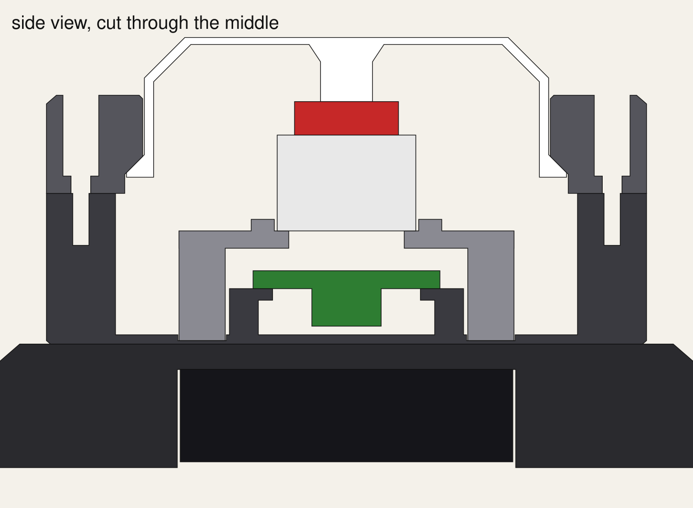

# The button's shell

Five printed parts around the carrier board. A hexagonal base, because Twilight Imperium is made of hexagons, and a round, flat-topped cap with a 45° shoulder.



**Revision 0.1. Status: modelled, never printed.** Every dimension comes from datasheets and from `../pcb/make_board.py`, not from parts in hand. The script checks that no part overlaps another, at rest or fully pressed, and that is all it proves. Print one set and fit it before printing six.

About 103 mm across the base's flats (119 mm corner to corner), 84 mm across the turret, 78.5 mm tall, with a 70 mm cap.

## The parts

| File in `stl/` | Colour | What it does |
|---|---|---|
| `body.stl` | black | The turret. The board sits on four posts, with a pillar under the switch so a slap can't flex it. Slot for the USB-C plug on one flat; a channel on the opposite flat takes the battery leads up past the board's edge to J1. |
| `bezel.stl` | black | Screws down over the cap. Its bore guides the cap's skirt; a cone inside holds the cap's flange in and centres it. |
| `cap.stl` | white | What you hit. The top is 1.2 mm thick, which is the diffuser. A plunger runs down the middle and rests on the switch's stem; it is not clipped on, so side loads never reach the switch. |
| `shelf.stl` | any | Holds the 8-LED ring 12 mm above the board, on three of the board's four screws (the capacitor is in the way at the fourth). |
| `plinth.stl` | black | The base. The battery holder sits in a pocket underneath, cover and switch facing the table, so there is no battery door to design: pick the button up to switch it on or change cells. **This is the only part that depends on the holder. It is sized from an Amazon listing (70 × 65 × 20 mm). Don't print it until you have measured a real holder.** |
| `fit_test.stl` | any | Two thin rings, a quick print: a slice of the bezel's bore and a slice of the cap's skirt. The small ring should drop through the big one and slide freely without rattling. If it doesn't, change `SLIDE_CLEARANCE`. |

Every STL is already turned the way it prints: the cap, shelf and plinth are upside down, flat face on the bed. **No supports on anything.**

## How the press works

- The cap travels **2.8 mm**, then its flange lands on the top of the body's wall. Plastic takes the blow; the switch has 3.6 to 4 mm of travel and is never bottomed out.
- At rest the switch's own spring holds the cap up against the cone in the bezel. The cap weighs about 18 g and a keyboard switch pushes back with 25 to 40 g at the top, so it returns, but without a lot to spare. A heavier switch (BOX Jade) helps; so does a thinner `CAP_WALL`.
- An off-centre hit is carried by the skirt in the bezel's bore (top) and the flange in the chamber below it (bottom), about 15 mm apart. Hits right at the rim may still drag. A little dry PTFE or silicone grease on the skirt is the first thing to try.

## Printing (Bambu X1C, 0.4 mm nozzle)

- 0.2 mm layers, 3 walls, 15% infill, PLA or PETG. Black for everything except the cap.
- **Cap:** white PLA works; 1.2 mm of white glows well and hides the individual LEDs better than clear does. Translucent or natural PETG is brighter. Print it with 4 walls so the skirt and plunger come out solid. The textured plate gives the top face a matte finish; the smooth plate makes it glossy.
- Very roughly 120 g of black and 20 g of white per button; the slicer's figure is the one to trust.

## Screws

All **M3 × 8**, socket-head or pan-head, cutting their own thread in the plastic (drive them in gently the first time). Per button: 4 up through the plinth into the body's posts, 4 for the board (three of them down the shelf's columns), and 3 to 6 for the bezel. About 85 for six buttons.

## Assembly

1. **Plinth to body:** four screws up through the pocket's roof into the posts. Their heads sink flush.
2. **Battery holder:** thread its leads through the slot and up the channel in the body's wall, then stick the holder into the pocket with double-sided foam tape, cover facing out.
3. **Board:** solder the leads to J1 first (it's hard to reach afterwards). Drop the board onto the posts, USB toward the slot. One plain screw at the corner beside the big capacitor.
4. **Shelf:** over the switch, a screw down each of its three columns. Stick the LED ring on top with its wires through a gap in the rim.
5. **Cap**, resting on the switch. **Bezel** over it, three screws in alternate corners.

## Changing it

Everything is a named number at the top of `make_shell.py`.

```bash
python3 -m venv .venv && .venv/bin/pip install manifold3d numpy    # once
.venv/bin/python make_shell.py                                     # rewrites stl/ and the two cutaways
```

It must finish with `clash check: clean`. Set `MODULE_ON_BACK = True` if your ESP32 had to go on the underside of the board (the USB slot moves down to suit), and `HOLDER` to your holder's real size.

## Known gaps

- The shelf suits the 32 mm 8-LED ring only, not the 50 mm 12-LED ring.
- No hub enclosure yet.
- The USB slot's height assumes the ESP32 sits on the plastic spacers of its pin strips (port centre 5.1 mm above the board). The slot is 9 mm tall to forgive a millimetre or two.
