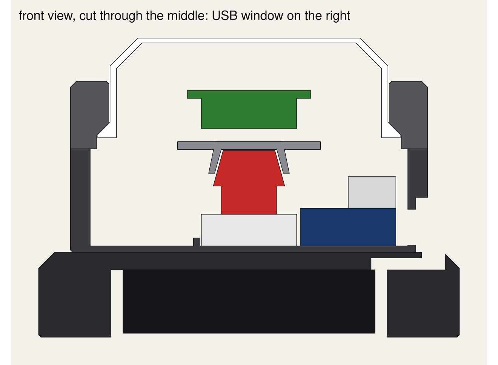

# The button's shell

Five printed parts around the plug-together electronics: an M5Stack AtomS3 Lite, a Mechanical Key Unit, a NeoHEX light board and four AAs. A hexagonal base, because Twilight Imperium is made of hexagons, and a round, flat-topped cap with a 45° shoulder. The hex rides inside the cap, so nothing sits between the LEDs and the diffuser.



**Revision 0.6 (2026-09-26).** v0.5 was printed and the press felt good (the springs are optional: they don't stay in their pockets, and the button works without them). v0.6 replaces the AA plinth with a **tray for a lithium cell and a Lipo Rider**, so the base is the turret's own 90 mm hexagon instead of 106; both USB-C ports come out of the +x face, the Atom's above the Rider's; and a **card rail** on the back holds one or two strategy cards leaning back 12°. Four screws go up from under the tray into the turret's wall corners; the floor posts are gone. **Not yet printed.** Sizes for the Rider and the card are marked MEASURE. The M5Stack sizes come from M5's own dimension drawings; the few that don't are marked `MEASURE` at the top of `make_shell.py`. The script checks that no part overlaps another, at rest or fully pressed, and that is all it proves. The electronics themselves were proven on the bench on 2026-09-24.

About 90 mm across the flats (104 corner to corner, 115 with the rail), 71 mm tall, with a 70 mm cap standing 14 mm above the bezel at rest and 11 mm pressed.

This revision uses the Atom's own socket plus a **Unit Hub 1-to-3 splitter** (U006), not the PortABC base: the base with the Atom on it is 60 mm long including the plugs and doesn't lie beside a centred key unit inside the turret. The firmware pins for the splitter wiring are the Atom's own: hex data on G2, key on G1.

## The mini (make_shell_mini.py, stl-mini/)

The same shell with the Key Unit and the splitter taken out: the AtomS3 sits in the middle, the hex plugs straight into it, and the cap presses the **Atom's own face button** through the cage. 76 mm across the flats, 56 mm tall, 56 mm cap: close to half the table of v0.5. The press is built so it doesn't feel like a tactile dome: the springs give 2 mm of free travel, then the cage's disc lands on the Atom's face and the dome clicks, then the stop, and the disc hangs on three 1 mm spiral flexures that absorb up to a millimetre of overtravel so the click always comes before the stop. The Atom's USB-C is inside (the Rider's cable comes up through a floor hole): flash by lifting the cap, or over the air. `USB_POWERED` at the top picks the build: True (the default, and what `stl-mini/` holds) is the demo that runs off the laptop's cable, with no deck and a notch through the bottom of the −x wall for the cable; False is the battery build with the deck and the Rider's cable up through the floor. **To build the USB one:** print body, cap, cage, the peg (`nub.stl`, prints head-down; push its stem into the hole in the cage's disc, a dab of glue if loose), bezel and three springs; Atom in its fence in the middle, USB-C facing the notch, cable out along the table; hex straight into the Atom's socket and dropped into the cage; cage up into the cap; springs in their pockets; cap on; bezel on three standoffs. Firmware 0.2.1+ reads the Atom's face as the big button and drives the hex on the Atom's own socket.

### Why an off-centre press bound, and the fix (2026-09-26)

A cap sliding in a bore is a plunger, and a plunger jams when the press lands more than about half the guide length divided by the friction coefficient off centre. The skirt only overlapped the collar by 7 mm; with PLA on PLA (about 0.35) that meant anything more than 10 mm off centre on a 28 mm cap started to bind, and 0.4 mm of clearance over 7 mm let it rock 3° first. Now a **sleeve** hangs from the cap's ceiling (inside the chamfer, outside the cage) and the platform's **collar** guides that: 12.7 mm of overlap at rest, 15.5 pressed, at 0.25 mm clearance. Print `fit_test` to check the clearance on your printer. Dry PTFE or a smear of silicone grease on the collar takes the friction to about 0.1, which by the same rule means the cap can be pressed anywhere. Glue the springs' feet into their pockets.

The click stack has three MEASURE guesses in it (the panel's drop, the Atom's height, the peg's seating), so `stl-mini/` has pegs from `nub-0.5` to `nub-2.5`: the right one is the shortest that still clicks before the stop, with the bezel seated.

## Three shells round the same cap (v1, v2, v3)

`make_shell_v1.py` is the seamless hex tower (76 across the flats, 58 tall: cell, Rider, platform, Atom, cap, all stacked). Two alternatives keep the cap, cage, peg, springs, collar and travel exactly as they are and change only what is under the Atom:

- **v2, the two-layer box** (`make_shell_v2.py`, `stl-v2/`): 72 × 72 mm with rounded corners, 50 mm tall. The cell and the Rider lie side by side on the lid inside full-height fences, and the fences hold the platform up (no columns). A square is the smallest shape that takes them side by side; a hex would need 84 mm across the flats. Three screws under the feet, four feet, the port in the +y wall. **No printed springs** since 2026-09-28: with no bezel pressing on it, the cap resting on the Atom's own switch through the peg returns by itself, and that felt better in the hand than the sprung one. The peg is 3.5 mm (`nub-3.0` and `nub-4.0` to choose from) to take up the 2 mm the springs held the cap up by. The stop moved with them: sprung, the cap travelled 2.8 mm and the cage's plate landed on the Atom's rim; unsprung, nothing caught the cap for 2.5 mm and the peg's three flexures took it (two of three snapped, 2026-09-28). The platform's collar is now 3.1 mm taller, so the cap's ceiling lands on it half a millimetre after the click, and a slap goes through the collar to the table. The flexures are 1.4 × 3.0 mm (1.0 × 2.2 until 2026-09-30, when one broke on the most-used button after many presses) with wider roots at both ends, where they crack; sized for that 0.5 mm, since six platforms were already printed to it. **The plug's corner** (2026-09-28): a USB-C plug's body is about 20 mm long, not the 12 first drawn, and straight out of a centred Atom it reached the round wall with no room to turn. The Atom is turned 45° so its socket points into the +x, −y corner (47 mm from the middle, not 33), the housing is opened into that corner up to 10 mm above the platform, the platform has a slot there for the cable to drop to the Rider, The check runs with a 22 mm plug drawn in. A hole through the corner wall was the way out if that was not enough; in the printed prototype the cable turned inside the corner with room to spare, so it is closed (`WALL_HOLE_OPEN`). The three screw bosses lean into their corners so that, printed upside down, they grow out of the walls and need no supports.
  **Redrawn round the real parts, 2026-09-30.** The Rider's port end carries both the USB-C and the battery socket, side by side, so the board cannot sit against the wall: it stands 6.5 mm off it, the charging window is on the real USB-C and big enough for a plug's body, and the battery is plugged in before the Rider goes into the lid. The switch is on the Rider's long edge, which now faces the +x wall 0.7 mm away, with a slot over it. The cell (34.5 × 52 × 9.9 as its maker lists it) is turned so its lead leaves beside the battery socket, in a pocket 0.75 mm loose all round. In one line the pocket has to hold the battery plug's room, the Rider, a straight USB-A plug and the cable's turn, 75 mm, so the box is **72 × 80**; `STRAIGHT_USB_A = False` draws it for right-angle plugs and it is 72 × 72 again. No screws since 2026-09-30 (`SCREWS`): the lid sits in its rebate and stays put, and a strip of tape does the rest; the bosses floated when printed and got in the way of everything inside. No foot recesses either (2026-09-30): the flat lid sits fine. **Platform guides** (2026-09-30 evening): three short ledges on the housing's inner walls (the cell side and the −x halves of the end walls, clear of the cable corner), 0.3 mm above the platform's top, reaching 2 mm in over its edge; upside down for assembly the platform rests on them in its game position instead of wandering while the cables are plugged, and right way up it is captive between them and the lid's fences. Each has a 45° back so it prints without support. The check runs with all four plugs drawn in. Positions along the Rider's edges are read off a photo and marked MEASURE.
- **v3, the one-layer pod** (`make_shell_v3.py`, `stl-v3/`): 72 × 98 mm, 38 mm tall, two printed parts round the cap. Nothing under the Atom: the lid is the floor (collar, Atom fence, spring pockets, cell fences on it) and the cell lies in a low tail behind the cap with the Rider on top of it, under the same flat roof the cap's lip is in. Springs at 0, 180 and 270 degrees, none toward the tail. Four screws, four feet, the port in the tail's +x wall.

- **v4, the slim one** (`make_shell_v4.py`, `stl-v4/`): 64 × 64 mm, 58 mm tall, 49 mm cap. The v2 box with everything pulled in as far as today's parts allow, about 78 % of v2's table. The mini's mechanics are rebuilt with a smaller cap (the generator rewrites the mini's parameters and runs it), the Rider goes back on top of the cell, and the Atom is turned so its USB-C faces the cable's hole. It needs a right-angle USB-A plug: a straight one behind the Rider does not fit a 59 mm pocket. Modelled and clash-checked, not printed; measure that plug, the USB-C plug's length out of the Atom (the bore leaves 17 mm) and the Rider's port before printing. Viewer: claude.ai/artifact/6SB33uPi6w4bNoUDjz2fky.

All three are clash-checked at rest and pressed, and viewable side by side at true scale on the comparison page (claude.ai/artifact/QKLn1FnnAUmjudd9YNhDKJ). Both alternatives share `check_and_write()` and `rbox_prism()` from `make_shell_v2.py`. Both are battery builds only.

## What's where

- **Key Unit** on the body floor, dropped onto two pegs that fit its own mounting holes, keycap on the axis. Its cable leaves toward −y.
- **Cage:** four legs with a cup at the bottom. The hex clicks into the legs from the top (LEDs up, sockets down), then the cage pushes up into four sockets on the cap's ceiling. The cup sits over the red keycap; press the cap and the whole cap-cage-hex moves together and the cup presses the key. The cup's brim keeps the press clear of the hex's sockets. The hex's cable loops down from its underside socket to the splitter.
- **AtomS3 Lite** lies flat against the +x wall with its USB-C in a **window through the wall**. The battery's USB-C plug, or the laptop's cable, plugs in from outside. The splitter is taped on top of it.
- **Cell and Rider** in the tray under the turret: the EEMB 963450 pouch flat on the tray floor at −x, the Rider above it along +x with its USB-C in a window in the tray wall. Its USB-A feeds the Atom through a short cable that loops outside between the two windows (or, if the Rider's header is fitted, a jumper inside; see HANDOFF).

## The parts

| File in `stl/` | Colour | What it does |
|---|---|---|
| `body.stl` | black | The turret: floor, key pegs, Atom bay, the USB window and lead groove, four screw posts, and a 36 mm inner collar the cap's skirt slides over (the real guide; open where the Atom and the key's cable are). |
| `cap.stl` | white / translucent | What you hit, with the hex cage hanging inside. The top is 1.2 mm thick, which is the diffuser. Print with 4 walls. |
| `cage.stl` | any | Four legs with a ledge the hex drops onto from the top, ending in a cup that sits over the keycap. Pushes up into sockets in the cap, whose bosses then hold the hex down. Nothing inside the button is loose. |
| `spring.stl` | any, PETG if you have it | **Print three.** Zigzag springs that stand under the cap's flange. Prints flat. `SPRING_B` sets the stiffness: 1.0 mm beams to start; 1.2 for firmer, 0.8 for softer. |
| `bezel.stl` | black | A 9 mm ring that screws down over the cap: a cone inside holds the cap's flange in and its bore steadies the top of the skirt. |
| `deck.stl` | black | The tray under the turret, printed open side up: cell and Rider inside, four screw columns, the Rider's USB-C window, and the card rail on the back. |
| `fit_test.stl` | any | Two thin rings, a quick print: a slice of the bezel's bore and a slice of the cap's skirt. The small ring should slide freely in the big one without rattling. If not, change `SLIDE_CLEARANCE`. |

Every STL is already turned the way it prints: cap and plinth are upside down, flat face on the bed; the cage prints cup-down, legs up; the spring prints flat. **No supports on anything.**

## How the press works

- The cap travels **2.8 mm**, then its flange lands on the top of the body's wall. Plastic takes the blow; the key's switch has about 4 mm of travel and is never bottomed out.
- Three printed springs, 1.7 mm pre-compressed at rest, push the cap up against the cone in the bezel and return it after a press. The switch only senses. If the press is too stiff or too soft, change `SPRING_B` and reprint three two-minute parts.
- Off-centre hits are carried by the skirt in the bezel's bore and the flange in the chamber below it. Hits right at the rim may drag; dry PTFE on the skirt is the first thing to try.

## Printing (Bambu X1C, 0.4 mm nozzle)

0.2 mm layers, 3 walls, 15% infill, PLA. Black for everything but the cap. **Cap:** white PLA glows evenly; translucent PETG passes more light. Print it with 4 walls. Roughly 130 g of black and 20 g of white per button; trust the slicer's number.

## Screws

Designed round a PC-case screw kit. **Bezel:** three of the brass **M3 6+6 standoffs**, threaded end down through the bezel into the body; the hex body sits in the countersink as the head and tightens by hand or with small pliers. M3 × 5 pan-heads work too (2.5 mm of bite). **Deck:** four M3 × 8 up through the tray's columns into the turret's wall corners (heads sink flush underneath). Skip anything M3.5 or M5; they'd split the posts.

## Assembly

1. **Body:** drop the Key Unit onto its pegs, socket toward −y. Atom into its bay with the USB-C in the window, splitter taped on top. Key cable → splitter → Atom.
2. **Springs:** stand the three springs in their floor pockets, outside the collar.
3. **Cage:** drop the hex onto the ledges, LEDs up. Plug its cable into an underside socket and lead it out between two legs. Push the cage's legs up into the cap's sockets until they seat (a dab of glue if loose); the sockets' bosses now hold the hex down.
4. Lower the cap over the body, cup onto the keycap, hex cable to the splitter, cables under the arches. **Bezel** over it, three standoffs.
5. **Deck:** cell flat on the tray floor at the −x side, Rider above it along +x with its USB-C in the window, both on foam tape; the cell's JST into the Rider (polarity checked first). Four screws up into the turret's corners. The Rider's USB-A cable goes out of the window and into the Atom's USB-C above it.

## Changing it

Everything is a named number at the top of `make_shell.py`. The old carrier-board version is `make_shell_pcb.py`. The cutaways are cut through the axis, so the cage legs (at 60° off the axes) don't appear in them.

```bash
python3 -m venv .venv && .venv/bin/pip install manifold3d numpy    # once
.venv/bin/python make_shell.py                                     # rewrites stl/ and the two cutaways
```

It must finish with `clash check: clean`.

## Known gaps

- The snap lips (0.9 mm) and the socket-cluster size on the hex's back are estimates. If the hex won't click in, shave `LIP`; if a pad lands on a socket, rotate `CAGE_ANGLES`.
- The screw-terminal USB-C plug's body hangs outside the wall in a shallow recess. A proper cover for it is a later revision.
- No hub enclosure yet.
